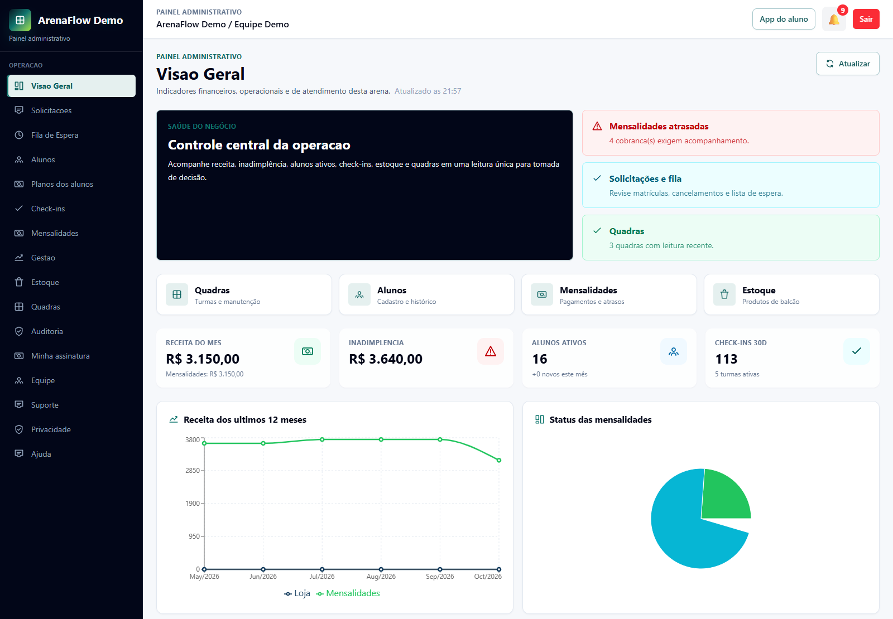
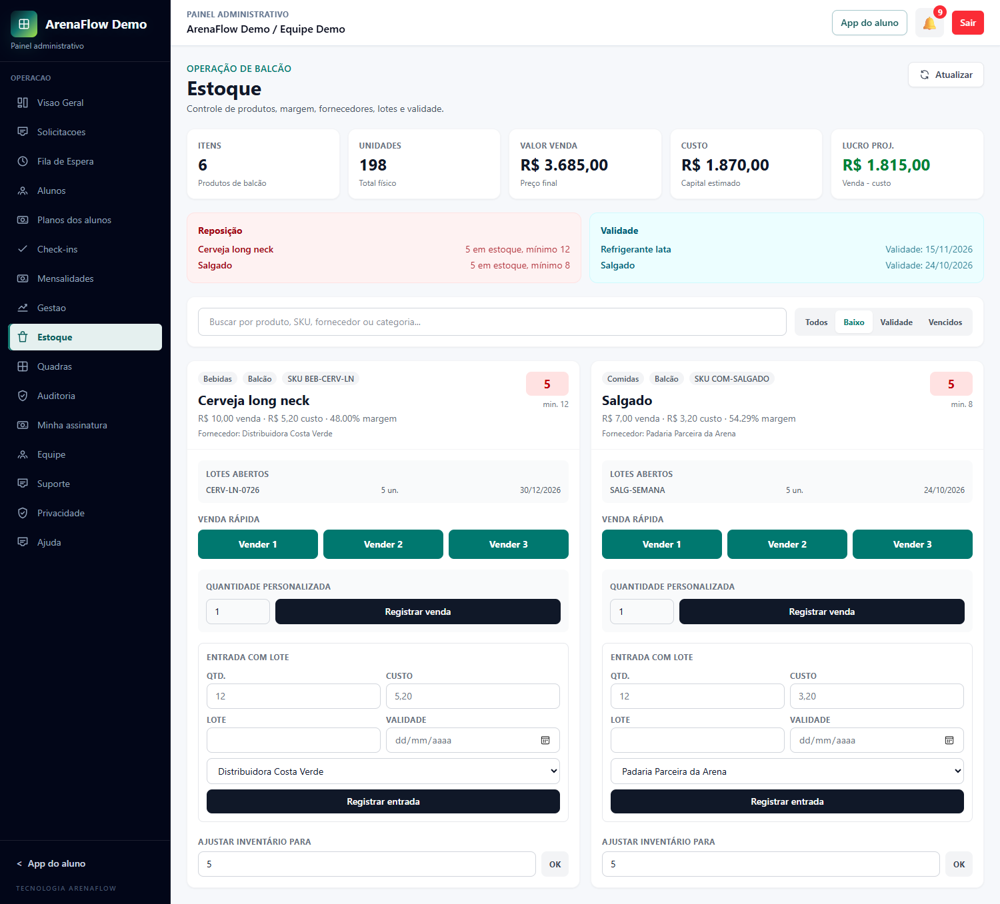
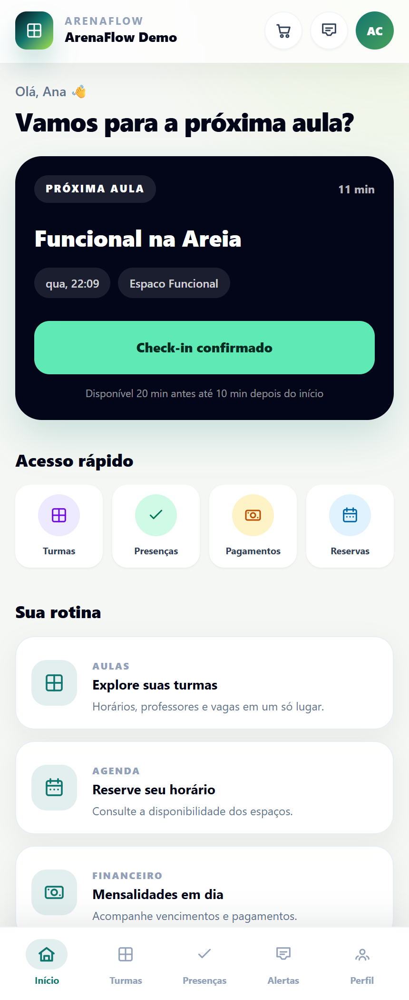

# ArenaFlow

O ArenaFlow é um projeto de portfólio para organizar o dia a dia de arenas esportivas e academias. A ideia é reunir matrículas, turmas, reservas, mensalidades e estoque em um sistema, com uma área para a administração e outra para os alunos.

**Em desenvolvimento:** o projeto já permite demonstrar os principais fluxos, mas ainda precisa de validação em uma operação real antes de uso comercial.

## Conheça as telas

As capturas abaixo foram feitas em um ambiente separado, com dados totalmente fictícios. Os valores, nomes e cadastros são exemplos de demonstração, não resultados de uma empresa real.

### Visão geral da administração

Indicadores de receita, mensalidades, frequência e ocupação das quadras.



### Controle de estoque

Produtos de balcão, alertas de reposição, lotes, validade e registro de vendas.



### Área do aluno no celular

Próxima aula, acompanhamento de check-in e acesso a turmas, pagamentos e reservas.



## Sobre este projeto

O ArenaFlow é parte do meu portfólio e um espaço para estudar como as diferentes partes de uma aplicação funcionam juntas.

Utilizo ferramentas de inteligência artificial como apoio no desenvolvimento. Minha participação inclui definir as necessidades do produto, testar os fluxos como usuário, identificar problemas e acompanhar as correções e a evolução do sistema. O projeto também é uma oportunidade de aprofundar meu entendimento do código, das tecnologias utilizadas e das decisões tomadas.

## Principais recursos

- Turmas, matrículas, fila de espera e solicitações de cancelamento.
- Check-in por aluno, turma e dia, com validação pela equipe.
- Reservas de quadras e acompanhamento de manutenções.
- Mensalidades, vencimentos e acompanhamento financeiro.
- Estoque de balcão, fornecedores, lotes, validade e loja no aplicativo.
- Área do aluno adaptada ao celular e instalável como aplicativo web (PWA).
- Acesso livre para academias, com confirmação de entrada e registro de saída.
- Diferentes arenas no mesmo sistema, com identidade visual, dados e permissões por unidade.
- Gestão de equipe, convites, recuperação de senha e registros de auditoria.

O código também inclui integração com Mercado Pago e ferramentas de operação do SaaS. Integrações externas dependem de configuração e homologação; sua presença no repositório não significa que estejam validadas em produção.

## Tecnologias

**Principais:** Python, Django, Django REST Framework, React, Vite e Tailwind CSS.

**Dados e tarefas:** SQLite no desenvolvimento, suporte a PostgreSQL e tarefas assíncronas com Celery e Redis.

**Testes:** Django, Vitest e Playwright. A cada atualização, o GitHub executa testes de backend, frontend e navegação, além de auditorias de dependências.

As configurações e os cuidados de implantação estão no [roteiro de deploy](docs/DEPLOY_RUNBOOK.md).

## Estrutura

```text
arenasystem/       Backend Django e APIs
arenasystem-web/   Frontend React e PWA
docs/              Decisões, operação e roteiros de validação
docs/images/       Prints com dados fictícios para apresentação
render.yaml        Blueprint de infraestrutura sem segredos
render.production.yaml  Configuração preparada para produção
```

## Execução local

### Backend

```powershell
cd arenasystem
python -m venv venv
# Windows: venv\Scripts\activate
pip install -r requirements.txt
copy .env.example .env
python manage.py migrate
python manage.py runserver
```

### Frontend

```powershell
cd arenasystem-web
npm install
copy .env.example .env
npm run dev
```

As variáveis dos arquivos `.env.example` são apenas referências. Credenciais, senhas e chaves reais não devem ser versionadas.

## Qualidade

```bash
# Backend
cd arenasystem
python manage.py check
python manage.py test
python manage.py makemigrations --check

# Frontend
cd arenasystem-web
npm run lint
npm run test
npm run build
npm run test:e2e
```

## Estado do projeto

O núcleo multi-tenant, a PWA, o check-in de aulas e o acesso livre estão implementados. Antes de uso comercial ainda são necessários homologação de integrações externas, testes em dispositivos reais, validação jurídica e piloto controlado. A agenda de aulas abertas/avulsas é uma evolução planejada.

Consulte a pasta [`docs`](docs/) para detalhes operacionais e critérios de validação.
